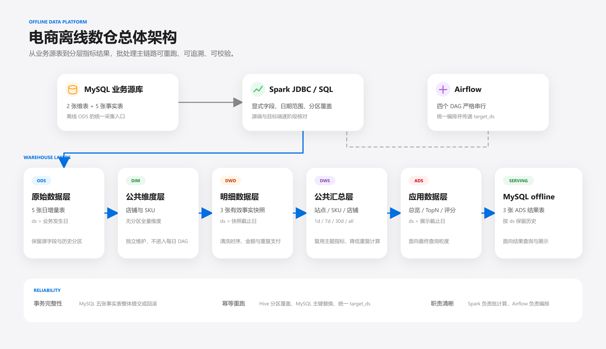
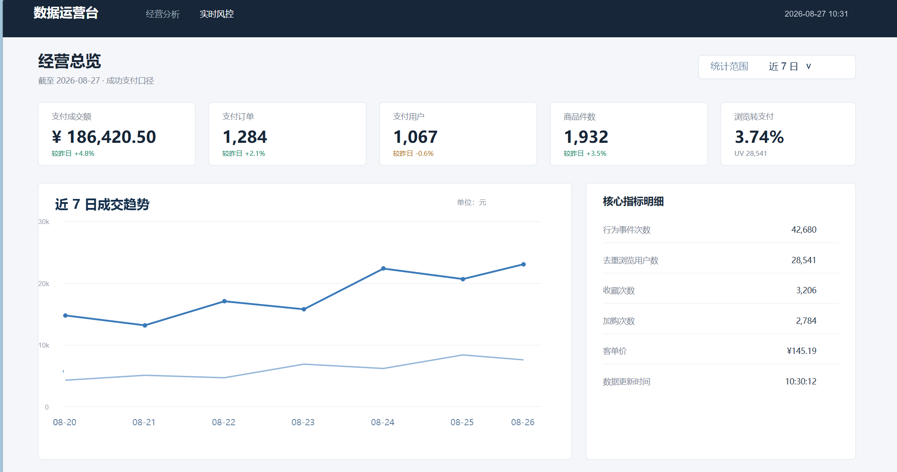
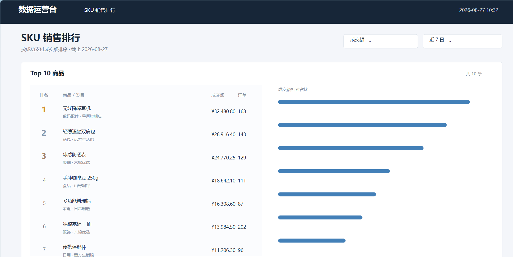
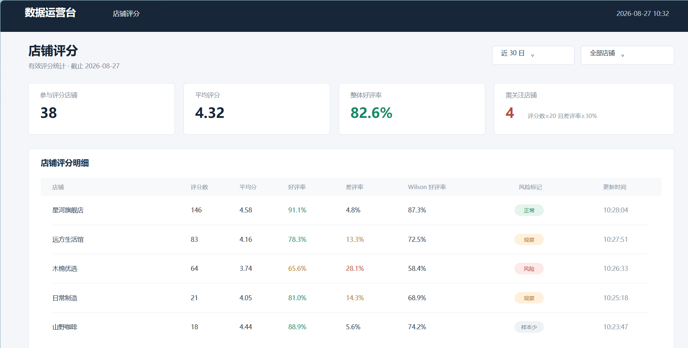
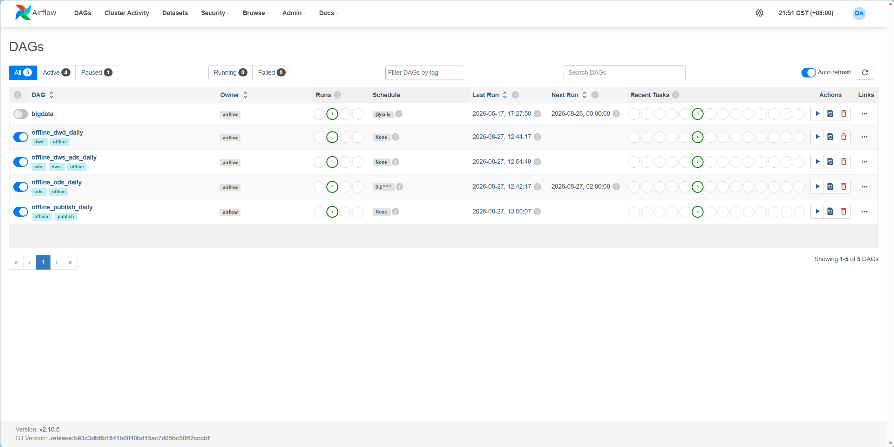
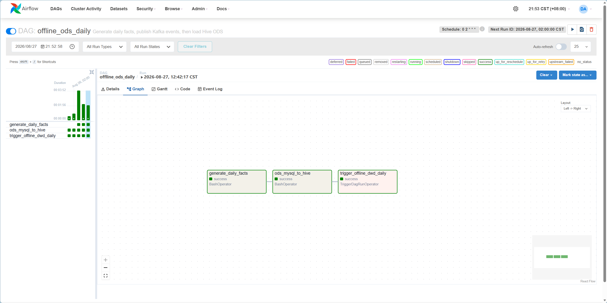
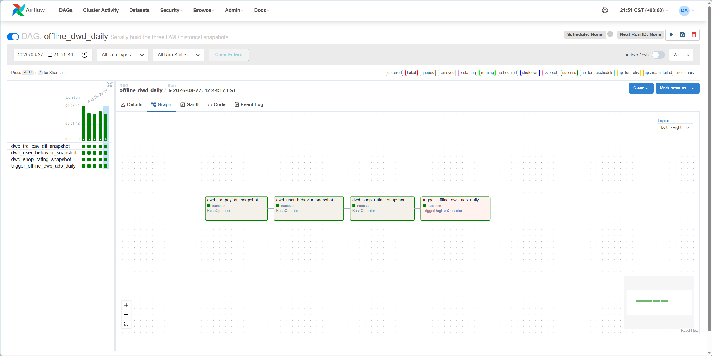
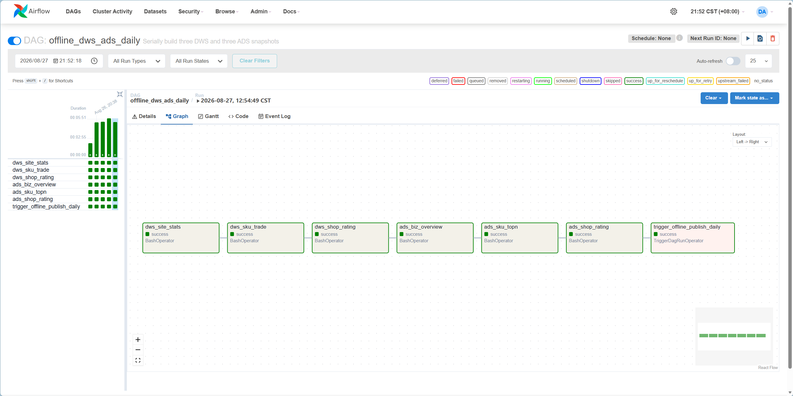
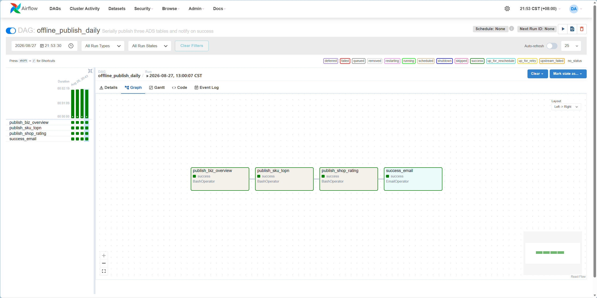

# 电商离线数仓与经营分析

基于 **Spark SQL、Hive 和 Airflow** 的电商离线数仓。从 MySQL 业务数据出发，完成 ODS、DIM、DWD、DWS、ADS 分层建设，输出经营总览、SKU 销售排行和店铺评分三类分析结果。

**技术栈：** Python · MySQL 8.x · Spark 3.5.8 · Hive / HDFS · Airflow 2.10.5

[总体架构](#总体架构) · [核心功能](#核心功能) · [结果展示](#结果展示) · [代码导航](#代码导航) · [详细设计](docs/design.md)

关联项目：[电商实时交易风控](https://github.com/jwdghmld/realtime_risk)。两个仓库分别负责离线经营分析与实时交易风险检测。

## 总体架构



- **离线主链路：** Python 造数器 → MySQL 业务库 → Spark JDBC → Hive 分层 → MySQL `offline` 结果库。
- **实时事件支路：** 造数器在 MySQL 事务提交成功后，将订单、明细和支付事件发布到 Kafka，供关联实时仓库消费。

离线计算读取 MySQL 与 Hive 数据；Kafka 事件由脚本主动发布，当前项目不使用 CDC。

## 核心功能

| 能力 | 实现内容 |
|---|---|
| 分层建模 | ODS 保存日增量，DIM 保存公共维度，DWD 构建有效明细快照，DWS 汇总主题指标，ADS 输出分析结果 |
| 多周期分析 | 统一计算 `1d`、`7d`、`30d`、`all` 四种统计周期 |
| 交易质量处理 | 校验支付时序、重复成功支付、明细金额与支付金额，过滤不符合口径的交易 |
| 任务编排 | 四个 Airflow DAG 串联采集、明细、汇总与发布，传递同一 `target_ds` |
| 指定日期重算 | Hive 按目标分区覆盖，MySQL 结果按日期删除后重新写入 |

**日期口径：** ODS 的 `ds` 是业务发生日；DWD 的 `ds` 是截至该日的完整有效快照；DWS 与 ADS 基于同一截止日计算。DIM 使用冻结维度，统一业务时区为 `Asia/Shanghai`。

MySQL 发布采用先删除、后写入的两阶段操作；成功重跑可重建该日结果，发布过程不保证原子替换。详细口径见[数仓设计](docs/design.md)。

## 结果展示

| 分析主题 | 主要内容 |
|---|---|
| 经营总览 | PV、UV、订单、支付用户、支付件数、GMV、客单价与转化率 |
| SKU 销售排行 | 按 GMV、支付件数、支付订单数分别生成 Top 10 |
| 店铺评分 | 平均分、好中差评、好评率、Wilson 好评率与风险标记 |

以下截图展示结果表的页面呈现；本仓库包含数据处理与结果发布代码，页面实现未包含在内。

### 经营总览



<details>
<summary>查看 SKU 销售排行与店铺评分</summary>

### SKU 销售排行



### 店铺评分



</details>

## 调度设计

```text
offline_ods_daily          造数、发布 Kafka、采集 ODS
  → offline_dwd_daily     构建三张 DWD 快照
  → offline_dws_ads_daily 计算 DWS 与 ADS
  → offline_publish_daily 发布三张 MySQL 结果表
```

ODS DAG 每天 02:00 启动，下游由前一阶段触发。当前配置适配本地集群资源，在各 DAG 内串行执行任务；完整依赖关系见[调度设计](docs/design.md#airflow-调度)。

<details>
<summary>查看 Airflow 运行与任务依赖截图</summary>



### ODS



### DWD



### DWS / ADS



### Publish



</details>

## 代码导航

| 想了解什么 | 代码入口 |
|---|---|
| 业务数据与风险样例如何生成 | [source-data-generator/](source-data-generator/) |
| MySQL 源表与结果表如何设计 | [contracts/mysql/](contracts/mysql/) |
| 数仓各层表结构 | [hive/ddl/](hive/ddl/) |
| MySQL 到 ODS 的日期范围采集 | [ods_mysql_to_hive_job.py](spark/ods/ods_mysql_to_hive_job.py) |
| 有效支付交易明细如何构建 | [dwd_trd_pay_dtl_snapshot_job.py](spark/dwd/dwd_trd_pay_dtl_snapshot_job.py) |
| 多周期汇总与应用指标 | [spark/dws/](spark/dws/) · [spark/ads/](spark/ads/) |
| DAG 依赖与业务日期传递 | [airflow/dags/](airflow/dags/) |

```text
offline_warehouse/
├── airflow/               # 四个离线 DAG
├── contracts/             # MySQL DDL 与 Kafka 事件合同
├── hive/ddl/              # 各层 Hive 表结构
├── source-data-generator/ # 维度、每日事实与交易事件生成
├── spark/                 # DIM / ODS / DWD / DWS / ADS 作业
├── docs/                  # 详细设计与项目截图
└── .github/workflows/     # Python 编译、造数器测试与 Shell 语法检查
```

## 相关文档

- [数仓详细设计](docs/design.md)：表粒度、指标口径、快照语义与结果发布边界。
- [Kafka 交易事件合同](contracts/kafka/topic-contract.md)：与实时仓库共享的 `1.0.0` 版本合同。
- [配置说明](docs/deployment.md)。
